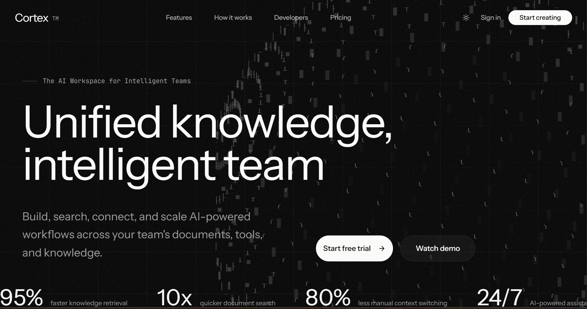
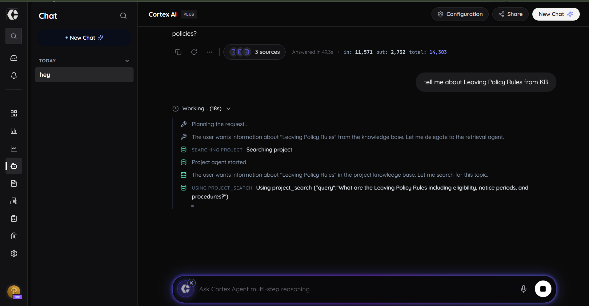
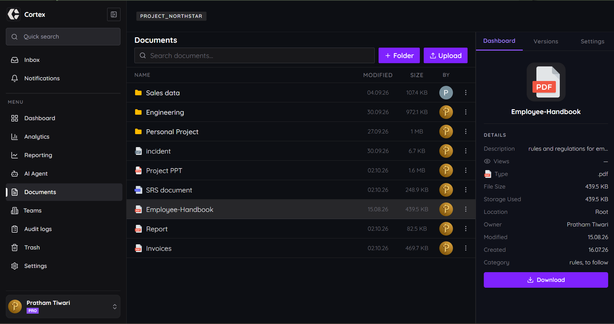
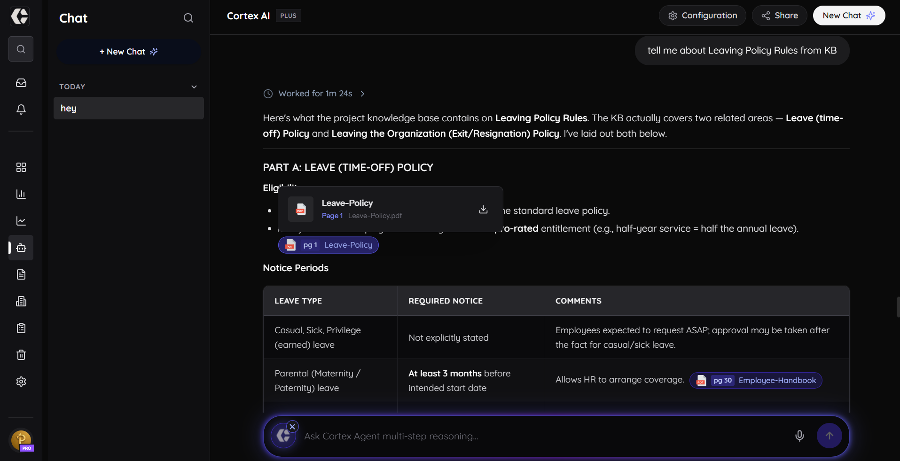
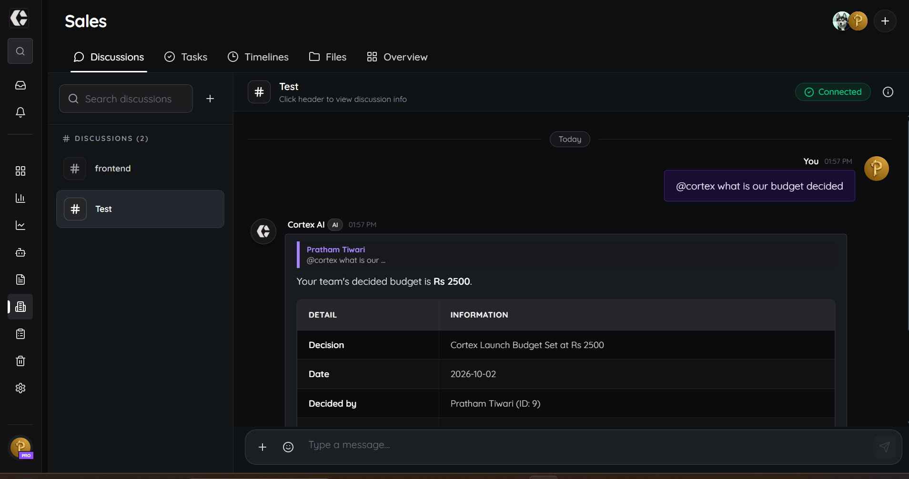
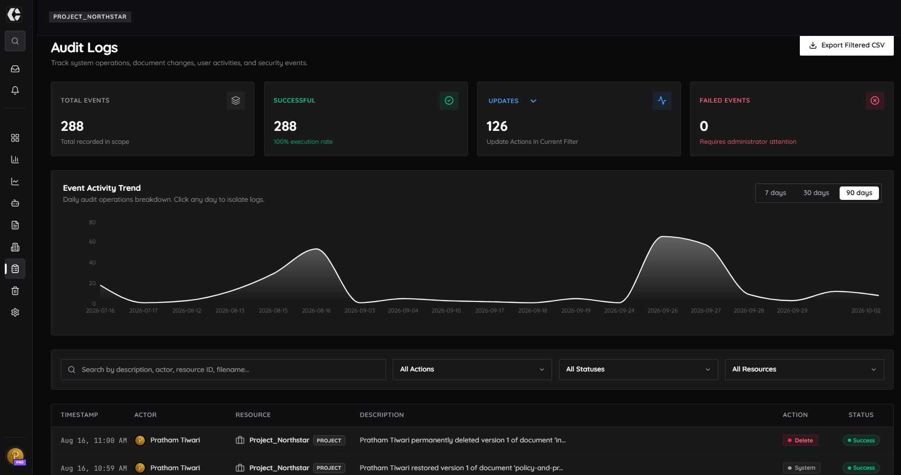
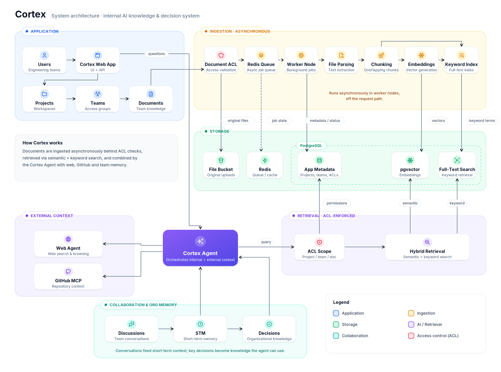
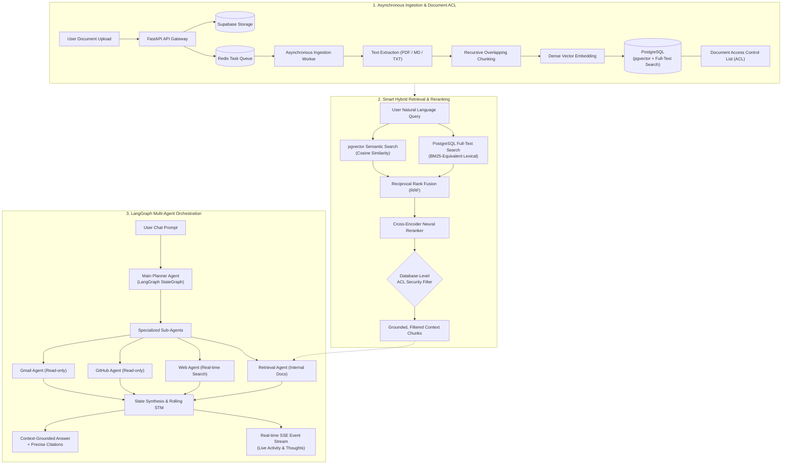
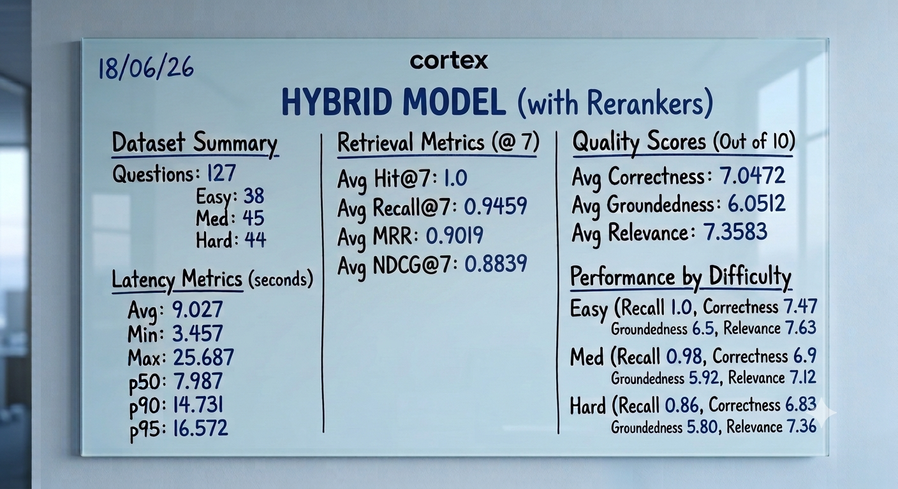
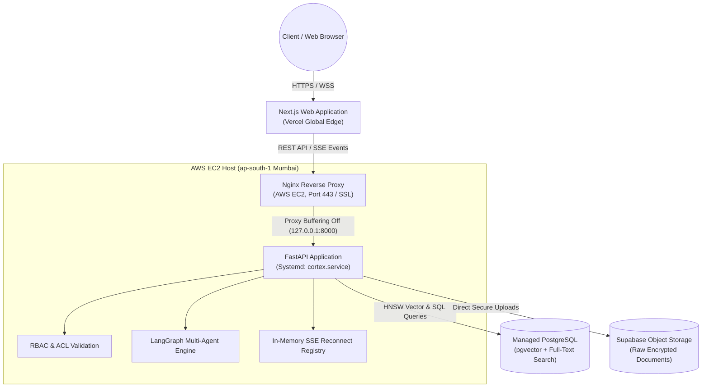

<h1 align="center">
  
  <br>
  Cortex
</h1>

<p align="center">
  <strong>Intelligent Organizational Memory & Decision-Support System</strong>
</p>

<p align="center">
  <em>"Your team's knowledge should never be lost."</em>
</p>


<p align="center">
  
</p>

---

## 💡 Core Product Philosophy

In modern engineering and product teams, valuable context is routinely lost across chat channels, outdated wikis, private drives, and turnover. When critical decisions are made, the reasoning behind them fades away.

**Cortex is built around a single foundational premise:**
> **Your team's knowledge should never be lost.**

Cortex is far more than a basic PDF chatbot or naive RAG wrapper. It is an **intelligent organizational memory and decision-support system** engineered to:
- **Capture Organizational Knowledge:** Centralize documents, specifications, team discussions, and architectural decisions.
- **Preserve Decision Context:** Record *why* decisions were made, what alternatives were considered, and who approved them.
- **Provide Smart, Grounded Retrieval:** Guarantee that answers are verified against team knowledge with page-level citations.
- **Execute Complex Multi-Step Reasoning:** Deploy autonomous LangGraph agents capable of querying internal knowledge, searching the web, and checking developer tools.
- **Enforce Defense-in-Depth Security:** Guarantee strict document Access Control Lists (ACL) and Role-Based Access Control (RBAC) directly inside database retrieval queries.

---

## 🌟 Key Capabilities

### 1. 🔍 Smart Hybrid Retrieval (Vector + Full-Text Search + Reranking)
Basic semantic search often misses exact identifiers, API route names, error codes, and technical jargon. Cortex pairs **pgvector dense semantic embeddings** with **PostgreSQL Full-Text Search (BM25-equivalent lexical ranking)**, merging the streams via **Reciprocal Rank Fusion (RRF)** and passing the top candidates through a **Cross-Encoder Reranker**.

### 2. 🤖 LangGraph Multi-Agent Orchestration
Beyond single-turn question-answering, Cortex utilizes an autonomous agent graph orchestrated via **LangGraph**:
- **Main Agent:** Plans multi-step reasoning, breaks down complex queries, and delegates sub-tasks.
- **Specialized Sub-Agents:** Dedicated sub-agents for internal project knowledge retrieval, real-time web search, GitHub repository inspection, and email context.
- **Streaming Thought & Activity (SSE):** Users watch the agent plan, invoke tools, and synthesize data in real-time.
- **Background Resilient Execution:** If a user submits a query and closes the tab or refreshes, the agent task continues executing on the backend and saves the response; reconnecting seamlessly restores the live activity stream.

<p align="center">
  
</p>

### 3. 🔒 Document Access Control (ACL) & Enterprise RBAC
Security cannot be an afterthought in organizational knowledge:
- Document access permissions (`Public`, `Internal`, `Restricted`, and `Team-only`) are enforced at **both the application API layer and database retrieval query layer**.
- Unauthorized document chunks are **never** retrieved into the LLM context window, preventing vector search leaks and data exposure across teams.

<p align="center">
  
</p>

### 4. 📚 Citations & Source Attribution
Every claim produced by Cortex is strictly grounded in organizational knowledge. The response displays:
- Exact document name, version, and page number.
- Matched text chunks and relevance scores.
- External web sources (when web search is leveraged).
- Full reasoning trace for verification and compliance.

<p align="center">
  
</p>

### 5. 🧠 Decisions, Discussions & Organizational Memory
Cortex captures the lifecycle of team collaboration. Discussions link directly to project documents, and architectural decisions are formalized with status tracking (`Proposed`, `Accepted`, `Deprecated`), rationale, and timeline visualization.

<p align="center">
  
</p>

### 6. 🛡️ Comprehensive Audit Logging
Maintains complete visibility and accountability across the organization by recording user actions, document uploads, permission changes, team updates, and retrieval operations.

<p align="center">
  
</p>

---

## 🏗️ System Architecture

Cortex connects secure document management, asynchronous ingestion, hybrid retrieval, agentic workflows, and team collaboration into a unified architecture.

<p align="center">
  
</p>

### Interactive Architecture Workflow



> 📖 **Want to explore the internal design of each module?**  
> Check out the [**Deep-Dive Architecture Documentation →**](./architecture/Readme.md) for full breakdowns of the security layer, ingestion queues, mathematical RRF formulation, and database schemas.

---

## 📊 Empirical Retrieval Evaluation & Benchmarking

To ensure high retrieval quality and avoid hallucinations, Cortex was benchmarked against a comprehensive evaluation dataset of **125+ real-world questions** spanning multiple categories, technical terminologies, and difficulty levels.

<p align="center">
  
</p>

### Benchmark Results

| Metric | Baseline (Dense Semantic Only) | Cortex (Hybrid Search + Reranker) | Relative Improvement |
|:---|:---:|:---:|:---:|
| **Hit@7** | 0.9600 | **1.0000** | **+4.2%** |
| **Recall@7** | 0.8990 (89.9%) | **0.9459 (94.6%)** | **+5.2%** |
| **MRR (Mean Reciprocal Rank)** | 0.7560 | **0.9019** | **+19.3%** |
| **nDCG@7** | 0.7580 | **0.8839** | **+16.6%** |

### Evaluation Insights
- **Hybrid RRF eliminates zero-recall failures:** Pure dense vector search frequently struggled with exact part identifiers, specific function names, and acronyms. Combining dense vectors with PostgreSQL full-text search brought candidate coverage to 100% (Hit@7 = 1.0000).
- **Cross-Encoder Reranking boosts precision:** The reranking stage re-orders the candidate pool by evaluating token-level cross-attention between question and candidate, resulting in a **+19.3% leap in Mean Reciprocal Rank (MRR)**.

> For evaluation scripts, datasets, and methodology, see [`cortex-backend/rag/evaluation/readme.md`](./cortex-backend/rag/evaluation/readme.md).

---

## 🧩 Technology Stack

| Layer | Technology | Role & Purpose |
|:---|:---|:---|
| **Frontend** | [Next.js 14](https://nextjs.org/) (App Router), React 18, TypeScript, Tailwind CSS | High-performance interactive UI with Server-Sent Events (SSE) streaming and real-time activity rendering |
| **Backend API** | [FastAPI](https://fastapi.tiangolo.com/), Python 3.12, Uvicorn | Asynchronous high-throughput REST API with SSE endpoints and decoupled background tasks |
| **Agent Framework** | [LangGraph](https://www.langchain.com/langgraph), LangChain | Stateful multi-agent graph orchestration, sub-agent delegation, and rolling memory management |
| **Database & Vector** | [PostgreSQL 16](https://www.postgresql.org/), [pgvector](https://github.com/pgvector/pgvector) | Relational storage for metadata, documents, ACL, and HNSW cosine similarity search |
| **Search Engine** | PostgreSQL Full-Text Search (tsvector/tsquery) + RRF | Native lexical keyword search combined with vector search via Reciprocal Rank Fusion |
| **Reranking** | Cross-Encoder Rerankers / BGE-Reranker | Neural reranking of retrieved candidates for maximum context precision |
| **File Storage** | Supabase Storage / S3-compatible | Secure document and asset storage |
| **Task Queue** | Redis + Background Workers | Non-blocking asynchronous document parsing, chunking, and embedding generation |
| **Cloud & DevOps** | AWS EC2 (Ubuntu 24.04 LTS), Nginx, Systemd, Certbot (SSL), Vercel | Production cloud deployment with reverse proxy, SSL termination, and automated edge hosting |

---

## 🚀 Deployment Architecture

Cortex is split into a modern edge frontend and a hardened cloud backend:



- **Frontend:** Hosted on [Vercel](https://cortexagent.site) with edge optimization.
- **Backend:** Hosted on an **AWS EC2 t3.small instance (Ubuntu 24.04 LTS, ap-south-1 Mumbai)** running FastAPI via `systemd` (`cortex.service`).
- **Nginx & SSL:** Configured with Certbot SSL certificates for `api.cortexagent.site`, handling TLS termination and streaming reverse proxy buffers (`X-Accel-Buffering: no`).

---

## 💻 Getting Started (Local Development)

### Prerequisites
- **Python 3.12+**
- **Node.js 18+ & npm/pnpm**
- **PostgreSQL 15+** with the `vector` extension installed (`CREATE EXTENSION vector;`)
- **Redis** (optional, for asynchronous document worker queues)

---

### 1. Clone Repository
```bash
git clone https://github.com/your-username/Cortex.git
cd Cortex
```

---

### 2. Backend Setup
```bash
cd cortex-backend

# Create and activate virtual environment
python -m venv venv
# Windows:
.\venv\Scripts\activate
# macOS/Linux:
source venv/bin/activate

# Install dependencies
pip install -r requirements.txt

# Configure environment variables
cp .env.example .env
# Edit .env with your PostgreSQL credentials, OpenAI/Groq API keys, and Supabase config

# Start FastAPI development server
uvicorn main:app --reload --host 127.0.0.1 --port 8000
```

---

### 3. Frontend Setup
```bash
cd ../cortex-frontend

# Install dependencies
npm install

# Configure environment variables
# Set NEXT_PUBLIC_API_URL=http://localhost:8000

# Start Next.js development server
npm run dev
```

Open [http://localhost:3000](http://localhost:3000) in your browser.

---

## 📖 Documentation Index

- [**System Architecture & Deep Dive**](./architecture/Readme.md) — Comprehensive architectural breakdown of ingestion, ACL, RAG, agents, and schemas.
- [**Retrieval Evaluation Report**](./cortex-backend/rag/evaluation/readme.md) — Benchmark datasets, metric formulations, and experimental observations.

---

<p align="center">
  <sub>Built with precision as a system-first approach to organizational intelligence and decision context.</sub>
</p>
