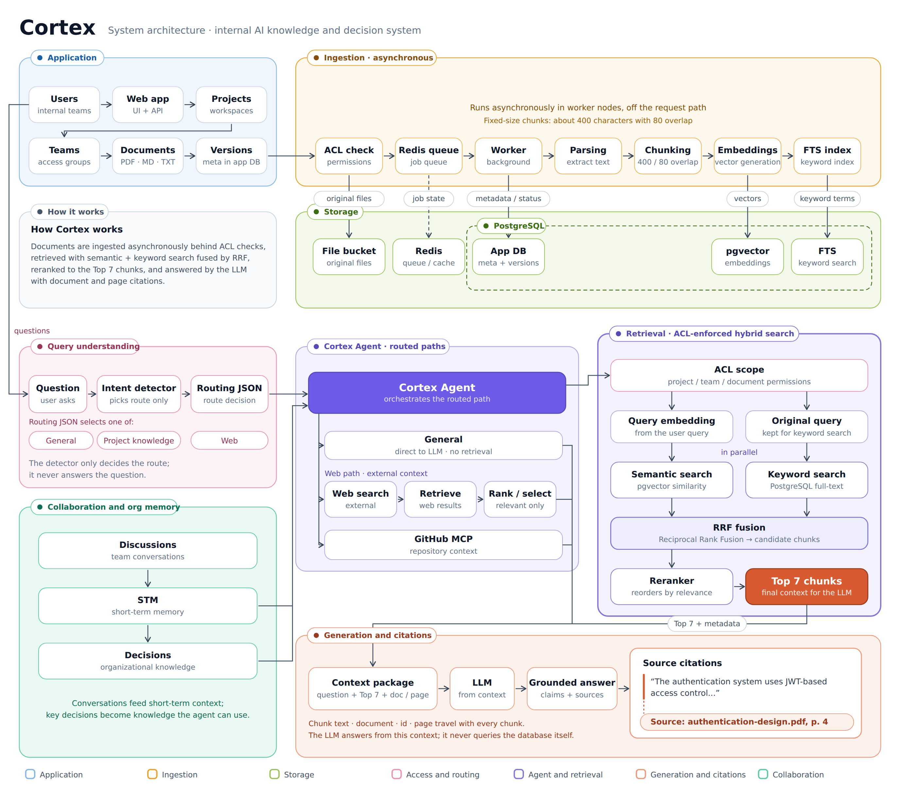
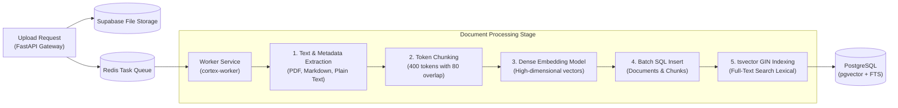
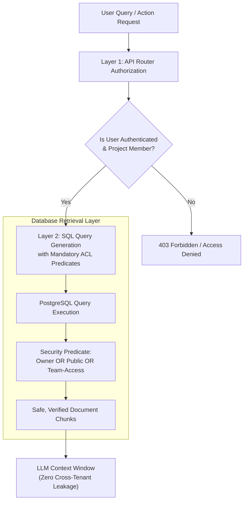
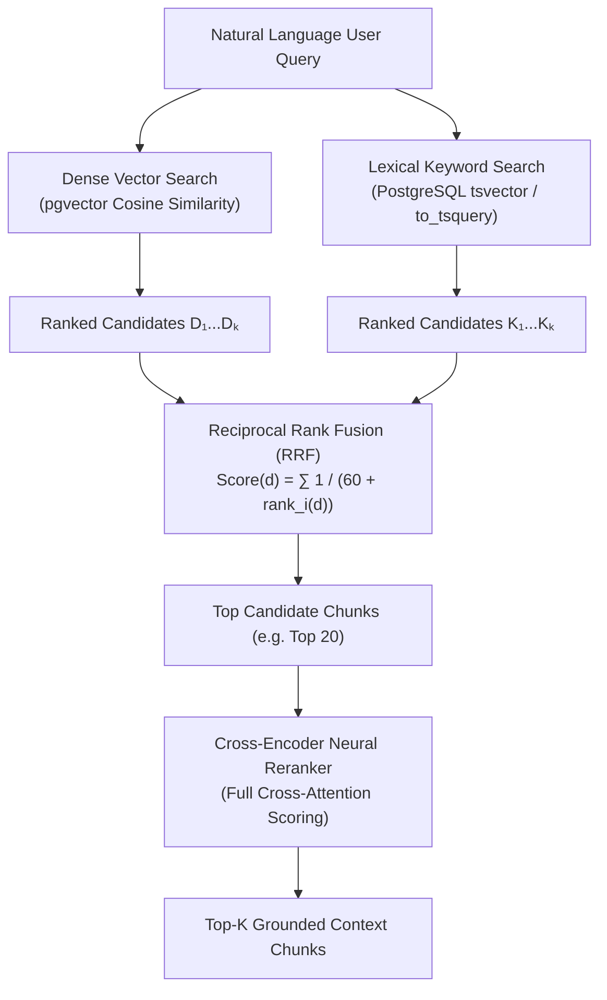
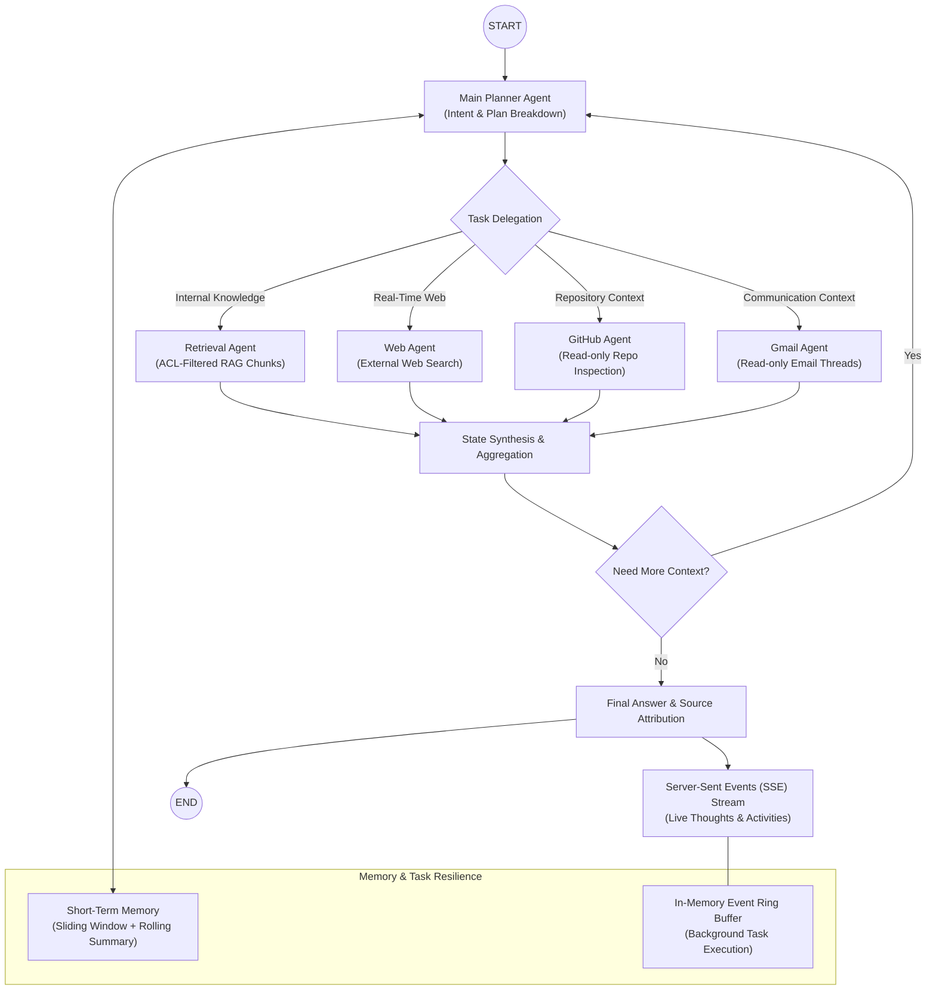
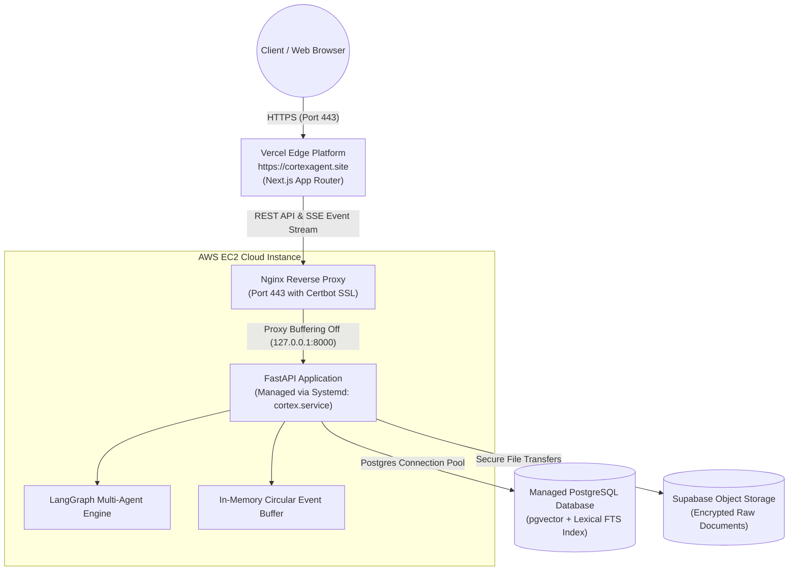

<h1 align="center">
  
  <br>
  Cortex System Architecture & Deep Dive
</h1>

<p align="center">
  <strong>Comprehensive architectural reference for the Cortex Organizational Memory and Decision-Support Platform.</strong>
</p>

---

## 🏛️ System Overview

Cortex is architected as a modular, distributed platform engineered around organizational knowledge capture, secure document intelligence, and autonomous agentic workflows. 

The system isolates resource-intensive ingestion from real-time API traffic, enforces defense-in-depth Access Control Lists (ACL) at the database layer, and orchestrates multi-agent reasoning graphs with live streaming feedback.

<p align="center">
  
</p>

---

## 📑 Architectural Modules

### 1. Document Ingestion & Asynchronous Worker Pipeline

Document ingestion in Cortex is asynchronous to prevent large document parsing, chunking, and vector embedding from blocking user API requests.



#### Pipeline Stages:
1. **Upload & Storage:** Raw files are validated and stored in Supabase Storage with unique file hashes to detect duplicate uploads.
2. **Asynchronous Dispatch:** Ingestion jobs containing document IDs and tenant/project metadata are pushed to a Redis task queue.
3. **Chunking Strategy:** Documents are parsed into structured text and segmented using token-based chunking configured at **400 tokens per chunk with an 80-token overlap** to maintain optimal semantic context boundaries without truncation.
4. **Embedding Generation:** Chunks are vectorized using high-dimensional dense embedding models and written into PostgreSQL using `pgvector`.
5. **Lexical Indexing:** In parallel, chunks are tokenized into PostgreSQL `tsvector` columns, enabling native BM25-equivalent full-text search indexing on the exact same chunks.

---

### 2. Document ACL & Role-Based Access Control (RBAC)

A core requirement of Cortex is ensuring that confidential organizational knowledge is **never leaked across teams or unauthorized users**.

Rather than relying solely on API endpoint authorization checks, Cortex implements **dual-layer defense-in-depth**:



#### Database-Level Security Predicates:
During hybrid retrieval, Cortex dynamically compiles the requesting user's accessible document IDs and team affiliations directly into the SQL query:
```sql
WHERE c.project_id = :project_id
  AND (
    d.access_level = 'public'
    OR d.owner_id = :user_id
    OR d.id IN (
      SELECT document_id FROM document_team_access WHERE team_id IN (:user_team_ids)
    )
  )
```
**Why this matters:** Even if an LLM is prompted adversarially or an agent attempts a broad search, the retrieval engine physically cannot return chunks from documents the user is not cleared to view.

---

### 3. Smart Hybrid Retrieval, RRF & Reranking Engine

Pure semantic search and pure keyword search each possess fundamental limitations:
- **Dense Vector Search:** Excels at semantic meaning, paraphrasing, and thematic similarity, but can fail on exact product codes, acronyms, or specific function names.
- **Lexical Search (BM25 / FTS):** Excels at precise keyword matches and unique tokens, but fails when users ask questions using different vocabulary.

Cortex combines both approaches via **Reciprocal Rank Fusion (RRF)** followed by a **Cross-Encoder Reranker**.



#### Reciprocal Rank Fusion (RRF) Formula:
$$\text{RRF}(d) = \sum_{m \in M} \frac{1}{k + r_m(d)}$$
where:
- $M$ is the set of retrieval systems (Dense Vector Search and Lexical Full-Text Search).
- $r_m(d)$ is the rank of document chunk $d$ in system $m$.
- $k$ is a smoothing constant (set to $60$), preventing high-ranked outliers from dominating the scoring.

#### Cross-Encoder Reranking:
Candidate chunks from RRF are passed into a cross-encoder model that scores the exact sentence-pair relationship between the query and each candidate chunk simultaneously. This eliminates false positives and elevates the most contextually relevant passages to the top.

---

### 4. LangGraph Multi-Agent Orchestration & Resilient Execution

Cortex leverages **LangGraph** to coordinate complex, multi-step agent workflows that exceed the capabilities of single-turn LLM calls.



#### Sub-Agent Responsibilities:
- **Main Agent:** Analyzes the user's intent, creates an execution plan, and routes queries to specialized sub-agents.
- **Retrieval Agent:** Interfaces with the hybrid RAG pipeline to pull ACL-verified organizational knowledge.
- **Web Agent:** Queries external search APIs for real-time market data, documentation, and external references.
- **GitHub Agent:** Inspects linked organization repositories, file trees, commits, and pull requests in read-only mode.
- **Gmail Agent:** Reads organizational threads and context (with write actions strictly disabled for safety).

#### Short-Term Memory (STM) Management:
The agent state maintains a sliding window of recent conversation turns paired with a rolling summary of older context. This prevents context-window exhaustion while preserving long-term conversational memory across extended sessions.

#### Resilient Background Execution & Ring-Buffer SSE:
To ensure user requests are never lost due to network fluctuations or tab closures:
1. When a query is initiated, the backend launches an **un-cancellable background task** (`asyncio.create_task`).
2. Event emissions (status updates, agent reasoning, tool invocations) are written to an **in-memory circular buffer** while simultaneously streaming via Server-Sent Events (SSE).
3. If the user disconnects or navigates away, the agent completes its run and commits the final answer and citations to PostgreSQL.
4. If the user returns while the agent is still running, the frontend reconnects via `GET /chats/{chat_id}/stream`, replays past events from the ring buffer, and streams incoming live events seamlessly.

---

### 5. Production Cloud & Infrastructure Architecture

Cortex is architected for high availability, security, and low latency across the stack:



#### Infrastructure Specifications:
- **Backend Host:** AWS EC2 `t3.small` instance running Ubuntu Server 24.04 LTS.
- **Service Management:** The FastAPI application is daemonized using a systemd service (`cortex.service`) with automatic restart policies and resource limits.
- **Nginx Reverse Proxy:** Terminates TLS 1.3 encryption, forwards HTTP requests to Uvicorn, and explicitly disables buffering (`proxy_buffering off;`) to deliver zero-latency SSE tokens to the frontend.
- **Frontend Hosting:** Global edge deployment on Vercel with automatic asset optimization, server-side rendering, and responsive UI caching.

---

## 🔗 Related Resources

- [**Main Project README**](../Readme.md) — High-level overview, feature showcase, and quick start guide.
- [**Retrieval Evaluation Deep Dive**](../cortex-backend/rag/evaluation/readme.md) — Benchmark data, empirical results, and ablation studies.
