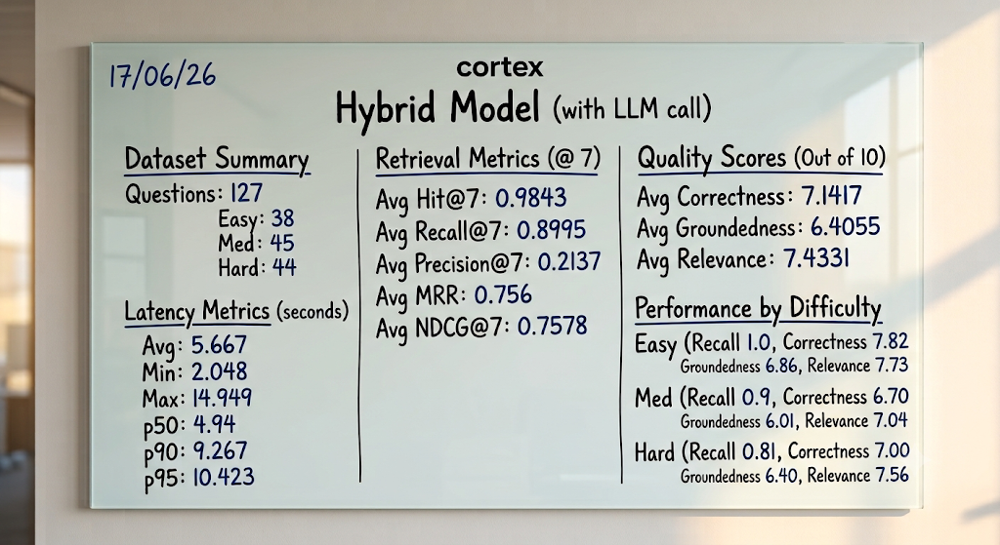
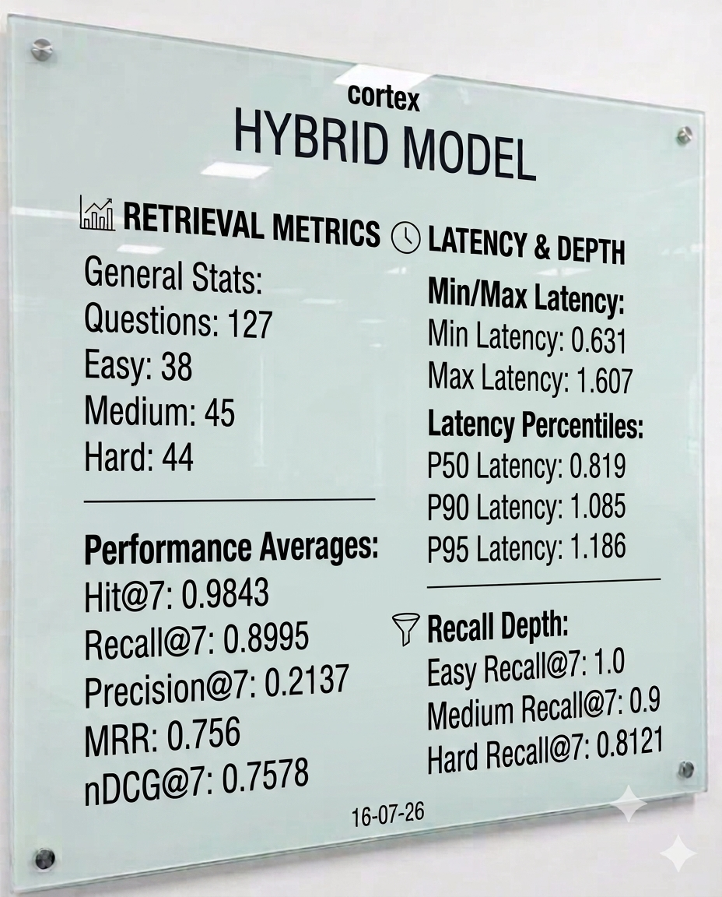

<h1>
  
  Cortex Hybrid Retrieval Evaluation 
</h1>

The Cortex Hybrid Retrieval pipeline was evaluated on a **127-question benchmark dataset** containing **Easy (38)**, **Medium (45)**, and **Hard (44)** questions. The evaluation measures both **retrieval performance** and **answer quality** using an LLM-based judge.

---

## Hybrid Retrieval + LLM Evaluation

This evaluation extends the retrieval benchmark by generating answers with the LLM and scoring their quality using an automated LLM judge.

  

> **Observation:** Along with retrieval metrics, the evaluation measures **Correctness**, **Groundedness**, and **Relevance** to assess the quality of generated answers.

>  **Note on Precision:** The Precision@7 of **~21.37%** does **not** indicate a weak system. The retriever always returns a fixed **top-7 chunks** by design, while most queries have only **1-2 relevant chunks**, so precision is mathematically capped (e.g., 1 relevant chunk in 7 gives a maximum of 14.28%)
---

##  Hybrid Retrieval Evaluation

The baseline evaluation measures how effectively the hybrid search pipeline retrieves the relevant document chunks before answer generation.

  

> **Observation:** The hybrid retrieval achieves high recall and ranking quality, making it a strong retrieval baseline.

---

## 📈 Evaluation Metrics

| Metric | Description |
|---------|-------------|
| **Hit@7** | Whether at least one relevant chunk appears in the top-7 retrieved results (1 if yes, 0 if no), averaged across queries. |
| **Recall@7** | Fraction of the expected (ground-truth) relevant chunks that were successfully retrieved within the top-7. |
| **Precision@7** | Fraction of the 7 retrieved chunks that are actually relevant. Capped at (number of relevant chunks / 7), so it stays low when few relevant chunks exist per query. |
| **MRR** | Mean Reciprocal Rank: the average of 1/rank of the first relevant chunk across queries. A score of 1.0 means the first relevant chunk is always ranked first. |
| **nDCG@7** | Normalized Discounted Cumulative Gain: measures ranking quality by rewarding relevant chunks that appear higher in the top-7, normalized against the ideal ordering (1.0 = perfect ranking). |
| **Latency** | Time taken to complete the retrieval (or retrieval + generation) pipeline. |
| **Correctness** | Measures how accurately the generated answer matches the expected answer. |
| **Groundedness** | Measures whether the generated answer is fully supported by the retrieved context without hallucinations. |
| **Relevance** | Measures how well the answer stays focused on the user's question without unnecessary information. |
